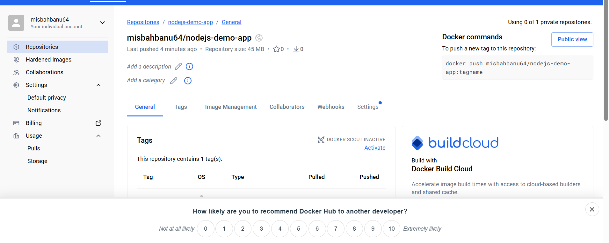

# Task 1: Automate Code Deployment Using CI/CD Pipeline (GitHub Actions)

## Objective
Set up an automated CI/CD pipeline using GitHub Actions and Docker to test, build, and push a Node.js web application Docker image to DockerHub automatically on every push to the `main` branch.

## Tools Used
- Git & GitHub
- GitHub Actions (`.github/workflows/main.yml`)
- Node.js & Express (`app.js`, `package.json`)
- Docker & DockerHub (`Dockerfile`)

## Folder Structure
- `.github/workflows/main.yml` — GitHub Actions CI/CD workflow configuration
- `Task-01/app.js` — Sample Node.js Express web server
- `Task-01/package.json` — Dependencies and automated test script
- `Task-01/Dockerfile` — Instructions to build the Docker image
- `Task-01/Screenshots/` — Execution screenshots (`CICD Pipeline.PNG` and `hub-docker.PNG`)
- `Task-01/README.md` — Project documentation and interview Q&A

## Implementation Summary
1. Created a sample Node.js Express application (`app.js` and `package.json`) listening on port `3000` with an automated `npm test` script.
2. Created a `Dockerfile` using `node:18-alpine` to install dependencies, copy source files, expose port `3000`, and start the server.
3. Configured `DOCKERHUB_USERNAME` and `DOCKERHUB_TOKEN` securely inside GitHub Repository Secrets (**Settings > Secrets and variables > Actions**).
4. Created `.github/workflows/main.yml` triggered on `push` to `main` that checks out code, sets up Node.js 18, runs `npm install` and `npm test`, logs into DockerHub, builds the Docker image from `./Task-01`, and pushes `misbahbanu64/nodejs-demo-app:latest` to DockerHub.

## Screenshots

### 1. GitHub Actions CI/CD Pipeline Success

### 2. Docker Image Pushed to DockerHub

## Interview Questions & Answers

1. **What is CI/CD?**
   Continuous Integration (CI) automatically builds and tests code whenever changes are pushed to a repository. Continuous Delivery/Deployment (CD) automates packaging and releasing that tested code (such as pushing a Docker image) without manual steps.

2. **How do GitHub Actions work?**
   GitHub Actions uses YAML workflow files stored inside `.github/workflows/`. When an event like `push` occurs, GitHub starts a runner virtual machine and executes the defined jobs and steps.

3. **What are runners?**
   Runners are the servers/machines (such as `ubuntu-latest`) that execute jobs in a GitHub Actions workflow.

4. **Difference between jobs and steps?**
   A Job is a group of tasks running on an isolated runner instance (jobs run in parallel by default). A Step is an individual command or action inside a job that runs sequentially on that runner.

5. **How to secure secrets in GitHub Actions?**
   Credentials like passwords and tokens are stored in **Settings > Secrets and variables > Actions**, where they are encrypted, masked in logs, and accessed via `${{ secrets.SECRET_NAME }}`.

6. **How to handle deployment errors?**
   By running automated tests before deployment, checking step-by-step execution logs in GitHub Actions, and rolling back to a previous working Docker image tag if an issue occurs.

7. **Explain the Docker build-push workflow.**
   The pipeline checks out the repository, logs into DockerHub using `docker/login-action`, builds the container image from the `Dockerfile` using `docker/build-push-action`, tags it, and pushes it to DockerHub.

8. **How can you test a CI/CD pipeline locally?**
   By using the open-source CLI tool `act` to run GitHub Actions workflows locally in Docker, or by running `npm install`, `npm test`, and `docker build` commands locally before pushing.
