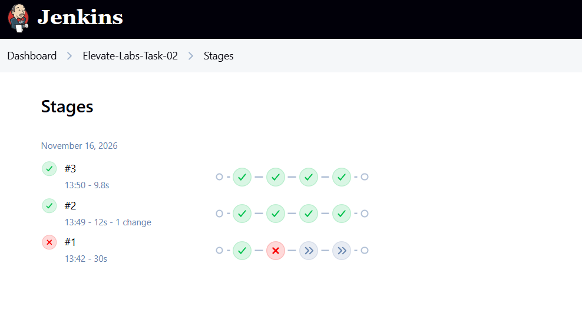

# Task 2: Create a Simple Jenkins Pipeline for CI/CD

## Objective
Set up a basic Jenkins pipeline using a declarative `Jenkinsfile` to automate building, testing, and deploying a web application on every code commit[cite: 16].

## Tools Used
- Git & GitHub
- Jenkins (`Task-02/Jenkinsfile`)
- Docker (`Task-02/Dockerfile`)
- HTML (`Task-02/index.html`)

## Folder Structure
- `Task-02/Jenkinsfile` — Declarative Jenkins pipeline with Build, Test, and Deploy stages[cite: 16]
- `Task-02/index.html` — Sample web application file
- `Task-02/Dockerfile` — Container build definition
- `Task-02/Screenshots/jenkins-pipeline.PNG` — Proof of successful Jenkins pipeline build
- `Task-02/README.md` — Task documentation and interview Q&A

## Implementation Summary
1. Created a sample web application (`index.html`), `Dockerfile`, and a declarative `Jenkinsfile` inside the `Task-02` directory[cite: 16].
2. Configured three automated stages inside `Jenkinsfile`: **Build**, **Test**, and **Deploy**[cite: 16].
3. Created a Pipeline job (`Elevate-Labs-Task-02`) in Jenkins connected to the GitHub repository (`misbabanu64/Elevate-Labs`) with `Task-02/Jenkinsfile` as the script path[cite: 4, 16, 25].
4. Enabled **Poll SCM** (`* * * * *`) so Jenkins automatically triggers the pipeline whenever new commits are pushed to GitHub[cite: 16].

## Execution Screenshot

### Jenkins CI/CD Pipeline Success

## Interview Questions & Answers

1. **What is Jenkins, and how is it used in CI/CD?**[cite: 16]
   Jenkins is an open-source automation server used to implement CI/CD pipelines. It automatically pulls code changes from version control (like GitHub), runs builds and automated tests, and deploys applications without manual intervention.

2. **What is a Jenkinsfile?**[cite: 16]
   A `Jenkinsfile` is a text file stored in the project repository that defines the entire CI/CD pipeline as code (Pipeline-as-Code), including its agent, triggers, stages, and steps.

3. **How do you create and configure Jenkins pipelines?**[cite: 16]
   In Jenkins, click **New Item**, select **Pipeline**, configure build triggers (such as **Poll SCM** or GitHub Webhooks), choose **Pipeline script from SCM**, enter the Git repository URL, branch (`*/main`), and the `Jenkinsfile` path, then save and run.

4. **What are some common stages in a Jenkins pipeline?**[cite: 16]
   Common stages include **Checkout** (pulling source code), **Build** (compiling or packaging the app/Docker image), **Test** (running unit/integration tests), and **Deploy** (releasing the application to staging or production).

5. **What is the difference between a declarative and scripted Jenkins pipeline?**[cite: 16]
   A **Declarative Pipeline** uses a structured, easier-to-read syntax starting with a `pipeline { ... }` block and predefined sections (`agent`, `stages`, `steps`). A **Scripted Pipeline** uses a `node { ... }` block written in full Groovy code, offering more programmatic flexibility for complex custom logic.
