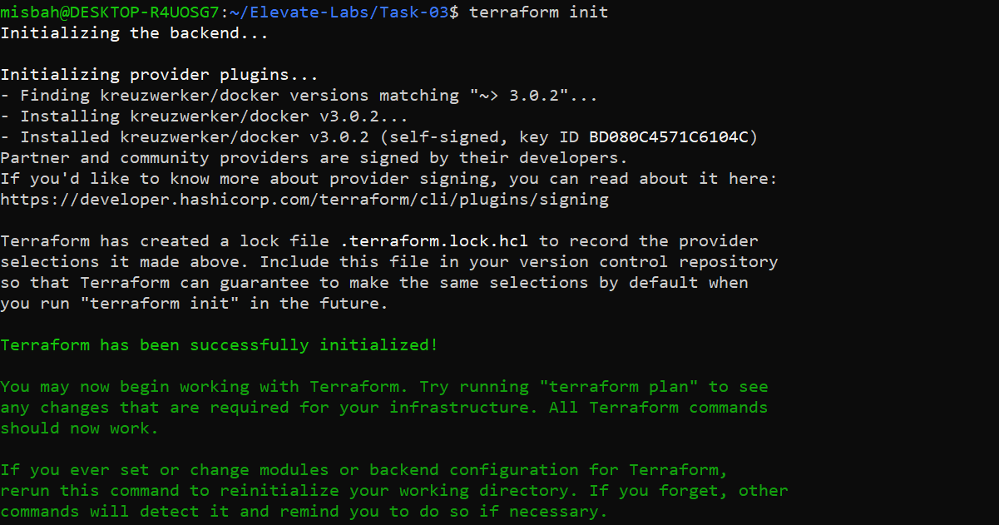
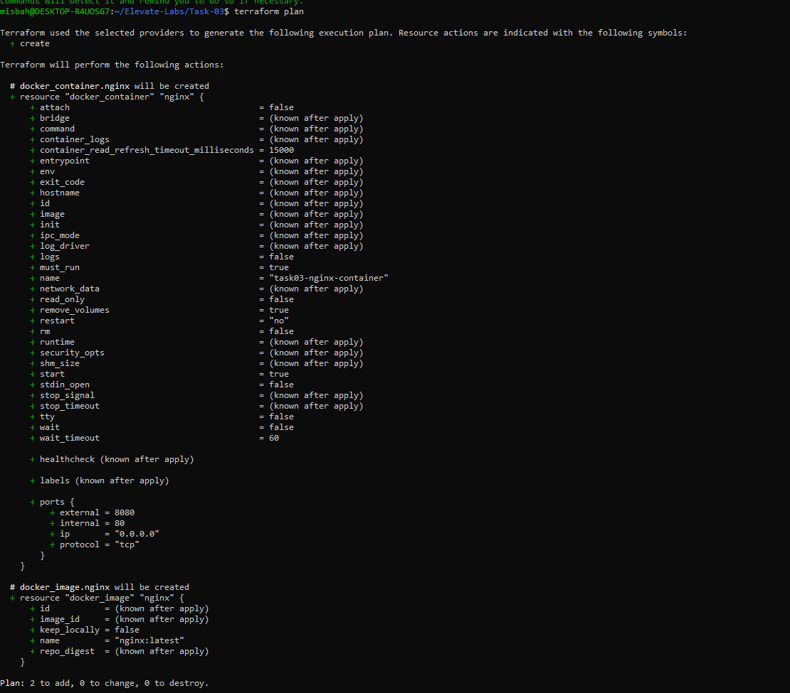
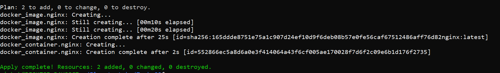
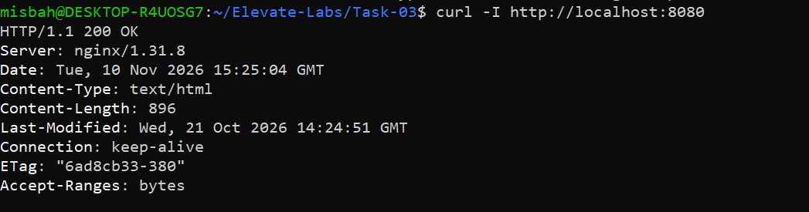
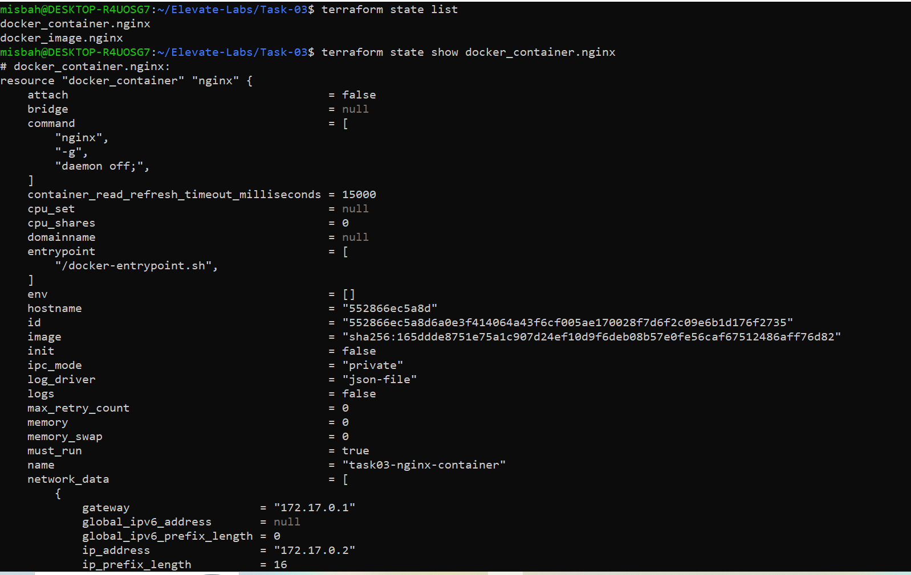
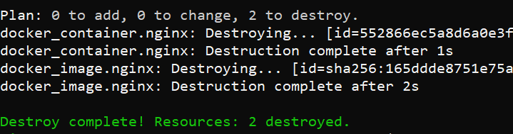

# Task 3: Infrastructure as Code (IaC) with Terraform

**DevOps Internship | Elevate Labs**

## Objective
Provision a local Docker container using Terraform (Infrastructure as Code).

## Tools Used
| Tool | Purpose |
|------|---------|
| Terraform v1.17.1 | Infrastructure as Code tool |
| Docker | Container runtime |
| Ubuntu (WSL) | Working environment |
| kreuzwerker/docker | Terraform Docker provider |

## Project Structure
```
Task-03/
├── main.tf                 # Terraform configuration
├── .terraform.lock.hcl     # Provider version lock file
├── .gitignore              # Ignores state files and .terraform/
├── README.md               # Project documentation
└── Screenshots/            # Execution evidence
```

## What main.tf Does
- Uses the **Docker provider** (`kreuzwerker/docker`)
- Pulls the official **nginx** image
- Creates a container named **task03-nginx-container**
- Maps host port **8080** to container port **80**

## Steps Performed

### 1. Initialize Terraform
Downloads the Docker provider plugin.
```bash
terraform init
```


### 2. Plan
Previews changes before applying. It showed **2 resources to add** (image + container).
```bash
terraform plan
```


### 3. Apply
Provisions the infrastructure.
```bash
terraform apply -auto-approve
```


### 4. Verify the Container
Checked the running container with Docker.
```bash
docker ps
```


### 5. Check Terraform State
Listed the resources tracked by Terraform.
```bash
terraform state list
```


### 6. Destroy
Removed all provisioned resources.
```bash
terraform destroy -auto-approve
```


## How to Run
```bash
git clone https://github.com/misbabanu64/Elevate-Labs.git
cd Elevate-Labs/Task-03
terraform init
terraform plan
terraform apply -auto-approve
# open http://localhost:8080
terraform destroy -auto-approve
```

## Interview Questions

**1. What is IaC?**
Managing and provisioning infrastructure using code instead of manual setup, so it is repeatable, versioned and automated.

**2. How does Terraform work?**
It reads `.tf` files, compares them with the state, builds a plan, and uses providers to create, update or delete resources.

**3. What is the Terraform state file?**
`terraform.tfstate` stores the mapping between the code and real resources, so Terraform knows what already exists.

**4. Difference between apply and plan?**
`plan` only previews changes. `apply` actually makes the changes.

**5. What are Terraform providers?**
Plugins that let Terraform talk to platforms such as Docker, AWS or Azure.

**6. What is resource dependency?**
When one resource needs another. Terraform understands this from references (e.g. the container uses `docker_image.nginx.image_id`) and creates them in the right order.

**7. How do you handle secret variables?**
Use `sensitive = true` variables, environment variables (`TF_VAR_*`), or a secret manager such as Vault. Never commit secrets or state files to Git.

**8. Benefits of Terraform?**
Automation, consistency, version control, reusable code, multi-cloud support, and easy destroy/recreate.

## Outcome
Understood how to provision and destroy infrastructure using IaC with Terraform and Docker.

## Author
**Misba Banu** ([@misbabanu64](https://github.com/misbabanu64))
