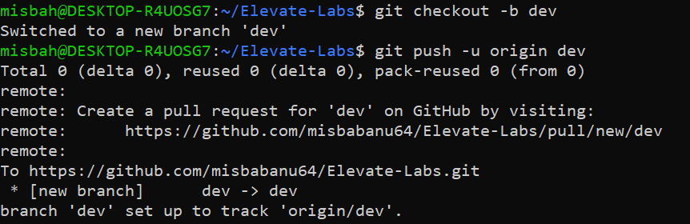
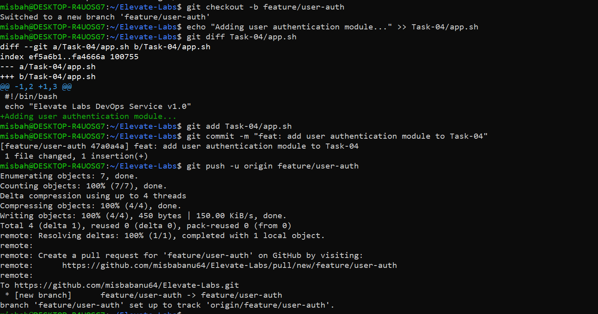
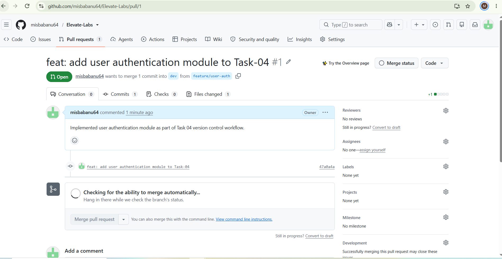
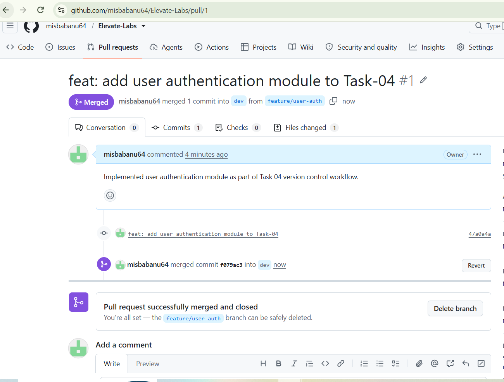

# Task 4: Version-Controlled DevOps Project with Git

**DevOps Internship | Elevate Labs**

## Objective
Manage a DevOps project using Git best practices: branching, pull requests, tags and proper documentation.

## Tools Used
| Tool | Purpose |
|------|---------|
| Git | Version control |
| GitHub | Remote repository and pull requests |
| Ubuntu (WSL) | Working environment |

## Project Structure
```
Task-04/
├── app.sh              # Sample DevOps script
├── .gitignore          # Ignores unwanted files
├── README.md           # Documentation
└── screenshots/        # Execution evidence
```

## Branching Strategy
| Branch | Purpose |
|--------|---------|
| `main` | Stable, production-ready code |
| `dev` | Integration branch for testing features |
| `feature/user-auth` | Feature branch for authentication work |

**Flow:** `feature/user-auth` → (Pull Request) → `dev` → (merge) → `main` → tag `v1.0.0`

## Steps Performed

### 1. Create the dev branch
```bash
git checkout -b dev
```


### 2. Create the feature branch, commit and push
```bash
git checkout -b feature/user-auth
git add .
git commit -m "feat: add user authentication"
git push origin feature/user-auth
```


### 3. Open a Pull Request
Opened Pull Request #1 on GitHub from `feature/user-auth` into `dev`.



### 4. Merge the Pull Request
Reviewed the changes and merged the PR on GitHub.



### 5. Sync and merge dev into main
```bash
git checkout dev
git pull origin dev
git checkout main
git merge dev
git push origin main
```

### 6. Create a release tag
```bash
git tag v1.0.0
git push origin v1.0.0
```

### 7. Verify the history
```bash
git log --oneline -n 5
```

## .gitignore
Used to keep unwanted files (logs, temporary files, secrets) out of the repository.

## How to Reproduce
```bash
git clone https://github.com/misbabanu64/Elevate-Labs.git
cd Elevate-Labs/Task-04
git branch -a
git tag
git log --oneline
```

## Interview Questions

**1. What is Git?**
A distributed version control system that tracks changes in files and lets many people work on the same project safely.

**2. What is the difference between merge and rebase?**
`merge` combines branches and keeps full history with a merge commit. `rebase` replays your commits on top of another branch, giving a clean, linear history. Do not rebase shared branches.

**3. What is a pull request?**
A GitHub request to merge changes from one branch into another. It allows code review, discussion and checks before merging.

**4. How do you resolve merge conflicts?**
Open the conflicted files, choose or combine the correct code between the `<<<<<<<`, `=======` and `>>>>>>>` markers, then run `git add <file>` and `git commit`.

**5. What are Git tags?**
Fixed labels on specific commits, usually used to mark releases such as `v1.0.0`.

**6. What is Git workflow?**
An agreed way of using branches in a team, for example `feature` → `dev` → `main` with pull requests and reviews.

**7. Explain git stash.**
Temporarily saves uncommitted changes so you can switch branches with a clean working directory. Use `git stash` to save and `git stash pop` to restore.

**8. What is the use of .gitignore?**
Tells Git which files or folders not to track, such as logs, build output, state files and secrets.

## Outcome
Learned the complete version control workflow: branching, pull requests, merging, tagging and documenting a DevOps project.

## Author
**Misba Banu** ([@misbabanu64](https://github.com/misbabanu64))
